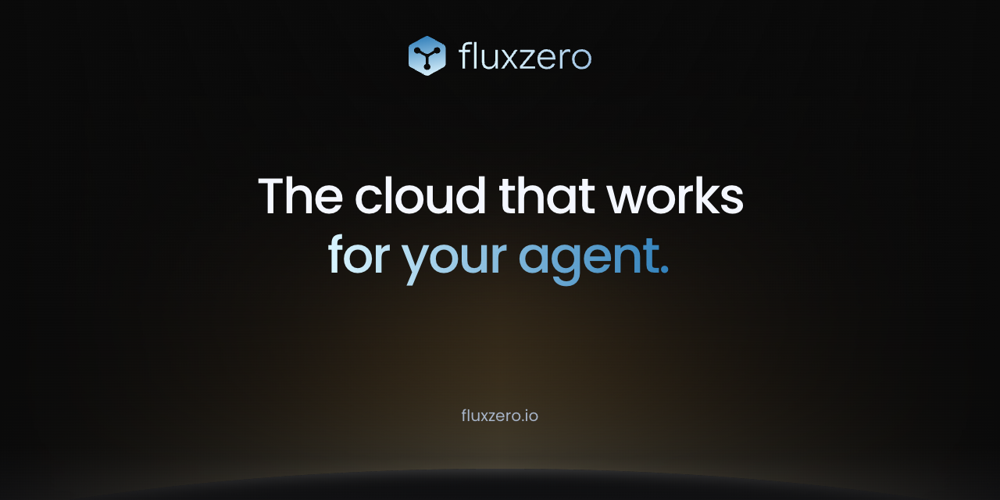

# Fluxzero brand assets

Current Fluxzero logos, banners, and social preview images for GitHub.

[Logo (SVG)](2026-10/fluxzero-logo.svg) · [Mark (SVG)](2026-10/fluxzero-mark.svg) · [Social preview (PNG)](2026-10/social/fluxzero.png)

## Organization and repository banner

## Social preview

## Organization avatar

## Maintenance

The current PNG artwork is rendered from the actual homepage background, logo, and Poppins fonts in the [website repository](https://github.com/fluxzero-io/fluxzero-site).

With that repository's local website running, use `node scripts/generate-social-card.mjs` to render the 1200 × 450 banner. Add `--github` to render the 1280 × 640 social preview. See the website README for Playwright setup. Inspect the exports and copy them to `2026-10/profile/hero.png` and `2026-10/social/fluxzero.png` respectively. All repository previews use the same artwork; their link titles identify the individual project.

The Python generator preserves the vector banner exports. It requires `fonttools` and `brotli` and accepts `--website /path/to/flux-website`. Existing tool buttons and the avatar remain in `2026-09`. Keep old asset URLs available for repository and release README links, and pin cross-repository links to an asset commit when updating them.

Fluxzero logos and branding are all rights reserved. Each software project defines its own license.
