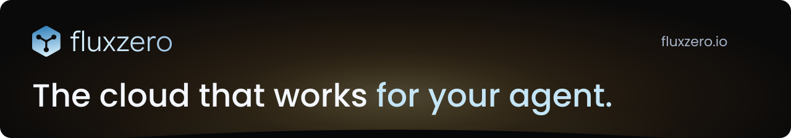
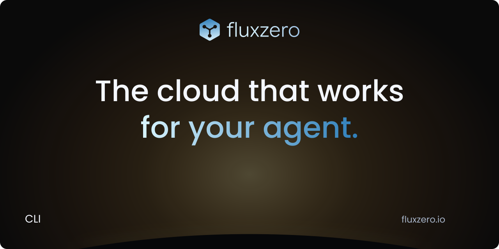

# Fluxzero brand assets

Logos, banners, and social preview images for Fluxzero repositories.

[Logo (SVG)](2026-09/fluxzero-logo.svg) · [Mark (SVG)](2026-09/fluxzero-mark.svg) · [Social previews](2026-10/social)

## Visual reference

### Organization banner


### Repository banner



### Social preview



### Organization avatar


## Maintenance

The original logo vectors and fonts live in the [website repository](https://github.com/fluxzero-io/fluxzero-site). To regenerate the SVG assets, install Python's `fonttools` and `brotli` packages and run this command from the repository root:

```sh
python scripts/build-brand-assets.py --website /path/to/flux-website
```

Export the social preview SVGs as 1280 × 640 PNGs and the avatar as a 512 × 512 PNG with an SVG renderer such as `sharp`. The current generator writes the October 2026 banners and social images; the existing tool buttons and avatar remain in `2026-09`. Keep existing asset URLs available for repository and release README links.

Fluxzero logos and branding are all rights reserved. Each software project defines its own license.
