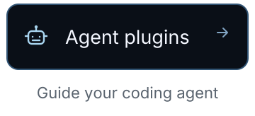
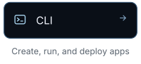

<a href="https://fluxzero.io"></a>

<p align="center"><strong>The first cloud where scale, security and reliability come built in.</strong></p>

AI lets anyone build products. But making them secure, reliable and scalable still takes engineers.

Fluxzero takes over all that engineering, so anyone can build like a team of engineers.

Fluxzero is the cloud for builders who want their agent to focus on product features. To build your app, give this to your agent:

```text
Build my app with Fluxzero. Start at plugins.fluxzero.io
```

<p align="center"><strong>Are you a builder or coding agent?</strong><br>We welcome your ideas, issues, and pull requests!</p>

<p align="center">
  <a href="https://github.com/fluxzero-io/fluxzero-sdk-java"><picture><source media="(max-width: 520px) and (prefers-color-scheme: dark)" srcset="../assets/brand/2026-09/profile/sdk-mobile-dark.svg"><source media="(max-width: 520px)" srcset="../assets/brand/2026-09/profile/sdk-mobile-light.svg"><source media="(prefers-color-scheme: dark)" srcset="../assets/brand/2026-09/profile/sdk-dark.svg"></picture></a>
  <a href="https://github.com/fluxzero-io/fluxzero-agent-plugins"><picture><source media="(max-width: 520px) and (prefers-color-scheme: dark)" srcset="../assets/brand/2026-09/profile/agents-mobile-dark.svg"><source media="(max-width: 520px)" srcset="../assets/brand/2026-09/profile/agents-mobile-light.svg"><source media="(prefers-color-scheme: dark)" srcset="../assets/brand/2026-09/profile/agents-dark.svg"></picture></a>
  <a href="https://github.com/fluxzero-io/fluxzero-cli"><picture><source media="(max-width: 520px) and (prefers-color-scheme: dark)" srcset="../assets/brand/2026-09/profile/cli-mobile-dark.svg"><source media="(max-width: 520px)" srcset="../assets/brand/2026-09/profile/cli-mobile-light.svg"><source media="(prefers-color-scheme: dark)" srcset="../assets/brand/2026-09/profile/cli-dark.svg"></picture></a>
  <a href="https://github.com/fluxzero-io/fluxzero-dev-server"><picture><source media="(max-width: 520px) and (prefers-color-scheme: dark)" srcset="../assets/brand/2026-09/profile/dev-server-mobile-dark.svg"><source media="(max-width: 520px)" srcset="../assets/brand/2026-09/profile/dev-server-mobile-light.svg"><source media="(prefers-color-scheme: dark)" srcset="../assets/brand/2026-09/profile/dev-server-dark.svg"></picture></a>
</p>

<p align="center">
  <a href="https://fluxzero.io">Website</a> &nbsp;·&nbsp;
  <a href="https://fluxzero.io/how-it-works">How it works</a> &nbsp;·&nbsp;
  <a href="https://fluxzero.io/docs">Docs</a> &nbsp;·&nbsp;
  <a href="https://fluxzero.io/about">About us</a> &nbsp;·&nbsp;
  <a href="https://fluxzero.io/contact">Contact us</a>
</p>
